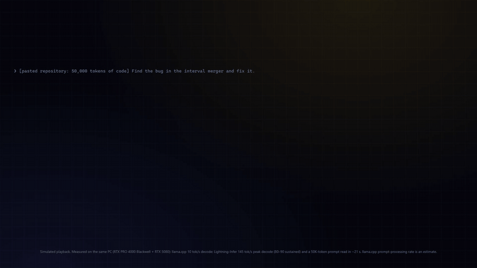
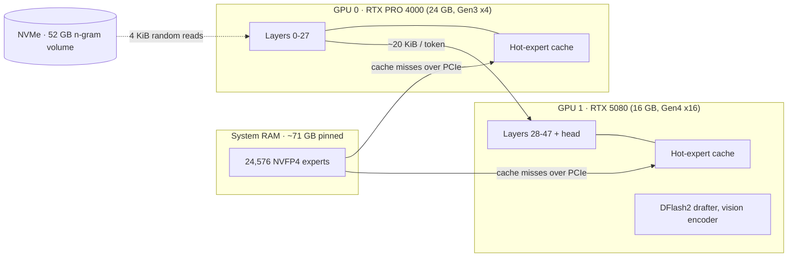

<div align="center">


# Lightning-Infer

**Run a 70 GB mixture-of-experts model on two ordinary NVIDIA GPUs, as fast as a small one.**

Local C++/CUDA inference engine for **Qwen3.8-Flash-Next**: 110-125 tok/s in coding sessions, peaks above 160 tok/s, 512K context, images and video, native Windows.




<sub>Simulated playback of measured rates on the same PC: llama.cpp 10 tok/s decode vs Lightning-Infer 145 tok/s peak. The llama.cpp prompt-processing rate in the video is an estimate. Full video: <a href="assets/demo-wide.mp4">16:9</a> · <a href="assets/demo-linkedin-4x5.mp4">4:5</a>.</sub>

</div>

---

## Overview

- **The problem.** Qwen3.8-Flash-Next is a mixture-of-experts model with 48 layers of 512 experts each
  (24,576 experts, about 70 GB at NVFP4), 10 routed experts plus one shared expert per token, hybrid
  linear/sparse attention and a 52 GB n-gram embedding table. It does not fit on any consumer GPU.
- **The approach.** Lightning-Infer splits the model by layers across two GPUs in the same PC, keeps
  every expert in pinned system RAM, caches the experts the conversation is actually using in VRAM,
  and reads the n-gram table from an NVMe volume. Speculative decoding (a DFlash2 block drafter plus
  copies from the conversation history) verifies several tokens per round.
- **The result.** 110-125 tok/s in warm coding sessions on an RTX PRO 4000 + RTX 5080 with no NVLink
  and no peer-to-peer access, more than 160 tok/s on turns that copy existing code. That is 8-14x
  llama.cpp and about 2.5-3x Strata on the same PC, with output bit-identical to a single-GPU run.

## Features

| Feature | Details |
|---|---|
| **Any two GPUs, even different ones** | A large and a small card on different links (one can sit in a chipset Gen3 x4 slot), no NVLink, no P2P. Each card holds its own layers, its own part of the KV cache and its own expert cache; about 20 KiB per token crosses between them through pinned host memory. A single GPU works too. |
| **No quality loss from the split** | Output is bit-identical to a single-GPU run: same replies, same logits, same perplexity. Every optimization is checked against this before it is merged. |
| **Speculative decoding** | DFlash2 block drafting with an automatic draft width, a proposal head for the LM-head draft, and n-gram copies of text already in the conversation, verified beside the DFlash2 block. The MTP drafter is available as an alternative. Every draft is verified, so drafting changes speed, never output. |
| **Built for coding agents** | Hybrid prefix cache that reuses what was already read across requests and subagents, robust tool calls, compaction-friendly long contexts. |
| **Long prompts** | 50K tokens of pasted code are read in about 21 s, 250K tokens in about 79 s. Context up to 524,288 tokens with YaRN. |
| **Images and video** | Vision encoder on the second GPU, in any request, without slowing text decode. |
| **Drop-in APIs** | OpenAI Chat Completions and Responses, Anthropic Messages, Prometheus `/metrics`. Tested with Codex, opencode, pi and Claude Code-style requests. |

## How it works



- **Weights.** The routed experts are imported bit-exactly from NVIDIA's NVFP4 checkpoint. The
  Dense8 conversion stores the dense projections (attention, shared experts, hyper-connection
  mixers, `lm_head`) as 8-bit weights; routers, norms and small tensors stay in BF16.
- **Expert cache.** Each GPU keeps the experts its layers use most in VRAM and promotes or evicts
  them as the topic of the conversation changes. The cache state can be saved and restored, so a
  restarted server starts warm.
- **N-gram table.** The per-layer n-gram embedding (PLE) is read row by row from the NVMe volume with
  unbuffered overlapped I/O, so it never occupies RAM.
- **Decode round.** Attention, routing and expert work run on the GPU that owns the layer; the hidden
  state crosses to the second GPU once per round. Draft tokens from DFlash2 and from conversation
  copies are verified together in one round of up to 8 columns.

## Performance

### Two GPUs (reference machine)

RTX PRO 4000 Blackwell (24 GB, PCIe Gen3 x4) + RTX 5080 (16 GB, PCIe Gen4 x16), Ryzen 9 5900X,
128 GB DDR4-3200, Windows 11. Production configuration: Dense8 artifact, INT8 KV, `--layer-split 28`,
DFlash2 with `--draft-tokens auto --lm-head-draft`, `--ngram-draft-tokens 7`, temperature 0 unless
noted. Speeds are decode tokens per second of output.

**Coding sessions** (20-turn coding conversation replayed from a fixed expert-cache state, 20 turns,
build `ff02a2a8`, 2026-10-27):

| Run | Mean over 20 turns | Last 10 turns (warm) | Warm range |
|---|---:|---:|---:|
| Production control, run 1 | 109.7 | 118.4 | 109.8-129.5 |
| Production control, run 2 | 119.2 | 121.5 | |
| Production control, run 3 | 122.1 | 124.5 | |

The three runs use the same binary, flags and inputs and give byte-identical replies; the spread
between them (up to about 9 %) is the run-to-run noise of this machine, so smaller differences are
not counted as gains.

**Copies of existing text** (A/B of n-gram copies beside DFlash2, build `ff02a2a8` against
`69ef2495`, two runs per arm, 38/38 replies byte-identical):

| Workload | Without copies | With copies | Change |
|---|---:|---:|---:|
| Coding agent | 117.1 | 120.8 | +3.2 % |
| Verbatim rewrite of a file | 121.9 | 163.1 | +34 % |
| Verbatim rewrite at 53.5K context | 105.6 | 141.5 | +34 % |
| Free prose | 81.2 | 83.1 | within noise |
| Copy of a ~250K-token context, warm | 104.6 | 125.4 | +20 % |

**Conversation and long context** (20-turn conversation with pasted code, about 50K tokens, second
half):

| Engine, same PC | Decode tok/s | Peaks | Reading 50K tokens |
|---|---:|---:|---:|
| **Lightning-Infer** | **80-90** | **120-145** | **~21 s** |
| Strata (OrcaRouter Q4_K_S), same two GPUs | 34 | 63 | 43-78 s |
| llama.cpp | 10 | | |

With the 512K window filled in 50K-token steps: 69 tok/s at 63K, 62 at 257K and 55 at 514K.
Reading a 250K-token prompt from an empty cache takes about 79 s (about 3,200 tok/s); the same
prompt served from the prefix cache starts in about 1 s.

**Prefix cache.** The default pinned host tier is 4 GiB. On a replay of one 150K-token agent session
and two 60K-token subagents, `--host-context-mib 8192` cut the total time to first token of nine
resumed requests from 68.7 s to 23.4 s (-66 %) and recomputed 91 % fewer prompt tokens, with
identical replies, for 4 GiB more pinned RAM.

**Measured and not adopted** (same-binary A/B, byte-identical replies): programmatic dependent
launch on the decode chain (+0.13 %, noise), a 256-thread QSA kernel for the PRO 4000 (-7.3 %),
16-column copy rounds (slower, and not byte-identical), a RAM cache for n-gram rows (no gain once the
volume is warm).

### One GPU (RTX 5090, Infernix base engine)

These figures are not measured on the reference machine above. They are copied from
[README.infernix.md](README.infernix.md#benchmarks): the Infernix engine that Lightning-Infer is
built on, at commits `3b35ccf9` and `63c672e4` (before the two-GPU work), on an RTX 5090 (32 GB) on
PCIe Gen5 x8, Core i9-13900K, 96 GB DDR5, Windows 11. Infernix runs the Dense8 conversion; Strata
runs Unsloth's UD-Q4_K_XL GGUF, its native format. Both use the model's MTP drafter and INT8 KV at
262,144 tokens.

**Context length** (one request, greedy, 1,024 output tokens; Infernix `3b35ccf9`, Strata 0.1.40):

| Context | Time to first token, Infernix | Strata | Decode tok/s, Infernix | Strata |
|---|---:|---:|---:|---:|
| ~8K | **1.9 s** | 12.3 s | **138.8** | 86.4 |
| ~128K | **17.9 s** | 103.3 s | **136.2** | 77.2 |
| ~250K | **34.2 s** | 158.1 s | **153.3** | 95.8 |

**Agentic replay** ([`bench/agentic_ab`](bench/agentic_ab/README.md): three coding-agent sessions
and eleven subagents with tool calls, compactions, retries and aborts, up to eight requests in
flight, temperature 1.0; three seeds, 68 requests each, range in brackets; Infernix `63c672e4`,
Strata 0.1.41):

| Metric | Strata | Infernix | Change |
|---|---:|---:|---:|
| Average time to first token | 32.9 s (30.9-36.8) | **5.9 s** (5.5-6.2) | -82 % |
| 90th-percentile time to first token | 67.8 s (62.0-75.1) | **13.3 s** (12.9-13.7) | -80 % |
| Prompt tokens served from cache | 53.8 % | **84.6 %** | +31 points |
| Prefill tok/s, requests with no cache hit | 1,423 | **5,879** | 4.1x |
| Output tok/s, one request decoding | 86 (83-88) | **125** (121-128) | +45 % |
| Output tok/s, at the run's own batching | 86 (83-88) | **143** (140-147) | +67 % |
| Workload wall time | 22.3 min | **7.8 min** | -65 % |

More single-GPU results, including Qwen3.8-27B against NInfer, are in
[README.infernix.md](README.infernix.md#benchmarks).

### Quality

Teacher-forced perplexity on three frozen texts (2,557 positions, INT8 KV, lower is better):

| Model | Perplexity |
|---|---:|
| Lightning-Infer, Dense8 conversion | **4.654** |
| Lightning-Infer, bit-exact conversion | 4.666 |
| Strata 0.1.40, UD-Q4_K_XL | 4.844 |

The two-GPU split produces the same logits as a single GPU, so these figures hold for both setups.

## Requirements

- **GPUs:** one or two NVIDIA Blackwell GPUs (RTX 50 series or RTX PRO Blackwell). The reference
  machine has 24 GB + 16 GB of VRAM.
- **RAM:** about 71 GB free for the experts; 128 GB recommended.
- **Disk:** an NVMe SSD for the 52 GB n-gram volume, plus about 75 GB for the model files.
- **OS:** Windows 11 with a recent NVIDIA driver.
- **Model:** the Qwen3.8-Flash-Next NVFP4 Dense8 artifact (`.infernix`), its `.ngram` volume and the
  DFlash2 companion. See the [model guide](docs/qwen3_8-flash-next.md#convert) for the conversion.
  The same recipe also converts
  [dealignai/Qwen3.8-Flash-Next-ABLITERATED-NVFP4](https://huggingface.co/dealignai/Qwen3.8-Flash-Next-ABLITERATED-NVFP4)
  (`--components text,vision`: its fused MTP experts are not supported, so it drafts with DFlash2
  only); it shares the n-gram volume of NVIDIA's checkpoint.

## Quick start

**1. Build** (Visual Studio 2022 Build Tools, CUDA 13.3, CMake and Ninja, vcpkg with ffmpeg and curl
for triplet `x64-windows` in `C:\vcpkg`):

```bat
call "C:\Program Files (x86)\Microsoft Visual Studio\2022\BuildTools\VC\Auxiliary\Build\vcvars64.bat"
set VCPKG_ROOT=C:\vcpkg
set VCPKG_TARGET_TRIPLET=x64-windows
set CUDA_PATH=C:\Program Files\NVIDIA GPU Computing Toolkit\CUDA\v13.3
cmake -S . -B build-windows -G Ninja -DCMAKE_BUILD_TYPE=Release -DCMAKE_CUDA_ARCHITECTURES=120a ^
      -DINFERNIX_BUILD_APPS=ON
cmake --build build-windows --parallel 8
```

The programs are written to `build-windows\bin`: `infernix-serve.exe` (server) and `infernix.exe`
(command line).

**2. Serve** with the production configuration (two GPUs, 512K context):

```bat
set CUDA_DEVICE_ORDER=PCI_BUS_ID
infernix-serve.exe Qwen3.8-Flash-Next-NVIDIA-NVFP4-Dense8-Infernix-00001-of-00003.infernix ^
  --ngram-volume Qwen3.8-Flash-Next-NVIDIA-NVFP4-Infernix.ngram ^
  --devices 0,1 --layer-split 28 --max-context 524288 --rope-yarn-factor 2 ^
  --spec dflash2 --draft-model Qwen3.8-Flash-Next-DFlash2-Infernix.infernix ^
  --draft-tokens auto --lm-head-draft --ngram-draft-tokens 7 ^
  --kv-dtype int8 --prefill-chunk 4096 --chat-template tools\chat_templates\qwen3_8.jinja ^
  --vision --tolerant-tool-calls --model-id qwen3.8-flash-next --host 127.0.0.1 --port 8891
```

**3. Connect** any OpenAI- or Anthropic-compatible client to `http://127.0.0.1:8891/v1` with the
model `qwen3.8-flash-next`.

**Flag notes**

- `--devices 0,1 --layer-split 28`: layers 0-27 on GPU 0, layers 28-47 and the head on GPU 1. Put
  more layers on the card with more VRAM. With `CUDA_DEVICE_ORDER=PCI_BUS_ID` the GPU numbers follow
  the PCI slot order.
- `--device N` instead of `--devices` runs on a single GPU.
- `--max-context 262144` without `--rope-yarn-factor` uses the native 256K window; the KV cache only
  occupies VRAM as the context fills.
- `--spec mtp --draft-tokens 4 --lm-head-draft` uses the MTP drafter instead of DFlash2.
- `--host-context-mib 8192` doubles the pinned host tier of the prefix cache (see Performance).
- `--chat-template` is needed for Codex (`developer` messages and `instructions`).

## Development

- **DeepSeek V4.1 Flash** (2-bit ISTA GSQ-RCO GGUF) is being ported on the `deepseek` branch: CPU and
  GPU expert tiers, exact sparse attention and a single-fill A/B benchmark. It is experimental and not
  part of the release.

## Documentation

- [docs/serving.md](docs/serving.md): server, APIs and every serving flag
- [docs/cli.md](docs/cli.md): command line
- [docs/qwen3_8-flash-next.md](docs/qwen3_8-flash-next.md): model guide, conversion and tuning
- [README.infernix.md](README.infernix.md): the underlying Infernix engine and single-GPU benchmarks

## Credits and license

Lightning-Infer is built on [Infernix](README.infernix.md), itself derived from
[NInfer](https://github.com/Neroued/ninfer) by Neroued. Licensed under Apache 2.0 ([LICENSE](LICENSE)).
Lightning-Infer's code was written with AI assistance (Claude Opus 5.5).

The demo video is generated from code with [Remotion](https://www.remotion.dev/); its source is in
[`media/demo`](media/demo).
